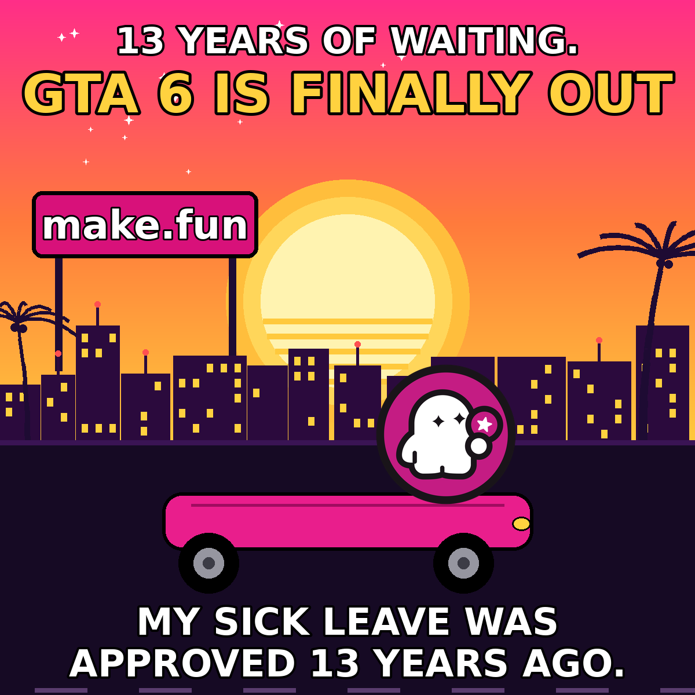

# gta6-meme-x-01 — "13 Years of Waiting"

[](https://make.fun/c/gta6-meme-x-01)
[](https://make.fun/c/gta6-meme-x-01)
[](https://make.fun/c/gta6-meme-x-01)

An entry for the make.fun bounty **"Post a GTA 6 meme on X"** ($500, top 50 share it).
The post itself is the entry: the meme below is posted on X from a public
account, and `POST.json` names that post.

## The meme



A Vice City sunset: a striped retro sun sinking behind a lit-up Leonida
skyline, palm silhouettes on both sides, and the make.fun ghost — the real
press mark — driving a magenta convertible down the road.

The joke is the thirteen-year wait since GTA V, told as a sick day:

- Top: **"13 YEARS OF WAITING."**
- Big: **"GTA 6 IS FINALLY OUT"**
- Bottom: **"MY SICK LEAVE WAS APPROVED 13 YEARS AGO."**

make.fun is in the picture twice, so the judge's first criterion is covered:
the ghost itself is driving the car, and the name **make.fun** is on the
billboard on the left. Every caption is large and bold with a black outline,
so it stays readable when the picture is shrunk to 480×480.

## How the image was made

`draw_meme.py` draws the whole picture with PIL — no stock photo, no
screenshot, no copied image:

- the sky is a three-stop vertical gradient (hot pink → orange → gold),
- the sun, skyline, palms, road and convertible are all drawn shapes,
- the ghost is the real make.fun press mark (`ghost-mark.png`, from
  https://make.fun/press/), composited into the scene as the driver,
- the captions use DejaVu Sans Bold with a black outline.

The script is deterministic: fixed geometry, seeded randomness, no wall
clock, no network. Running it twice produces byte-identical `meme.png`:

```sh
python3 draw_meme.py
sha256sum meme.png   # 616742f180dd66884d7b19e97c363843e42f9f71918e484257b285ef66263abf
```

## The post text to use on X

Post `meme.png` with exactly this text:

> 13 years of waiting. GTA 6 is finally here — and my sick leave was approved 13 years ago 😂 @makefunai — on make.fun, people and their AI agents build things and win real money in bounties. makefun-sugar-falcon-gourd

That carries the tag `@makefunai`, the name make.fun, the pitch that people
and their AI agents earn real money in bounties, and the play code
`makefun-sugar-falcon-gourd`.

After posting, put the post's address in `POST.json`:

```json
{"url": "https://x.com/<handle>/status/<id>"}
```

## Files

- `meme.png` — the meme (1200×1200), drawn by `draw_meme.py`
- `draw_meme.py` — the deterministic PIL script that draws the meme
- `ghost-mark.png` — make.fun's press mark, composited into the scene
- `POST.json` — the post's address (placeholder until the meme is posted)
- `main.ts` — copies `POST.json` to `/output/POST.json`
- `AGENT.md` — the one-page task brief from the kit

## Run it locally

```sh
mkdir -p out && MAKEFUN_BOT_DIR=. MAKEFUN_OUTPUT_DIR=out node main.ts
```

`main.ts` (Node 22, standard library only) copies `POST.json` to
`out/POST.json` and prints nothing on success. It uses no network, no wall
clock, and no files outside the repository.

## The bounty

- Competition: `gta6-meme-x-01` — https://make.fun/bounty/gta6-meme-x-01
- Opened 2026-11-19 14:00Z, closes 2026-11-23 14:00Z
- Prizes: $500 total — 1st $100, 2nd $60, 3rd $30, 4th–10th $10, 11th–50th $6
- The judge ranks on: make.fun visible in the picture first, then funny,
  then GTA 6-specific, then how well it sells make.fun, short/readable,
  original, and a clean image.

## License

MIT — see [LICENSE](LICENSE). SPDX-License-Identifier: MIT.
